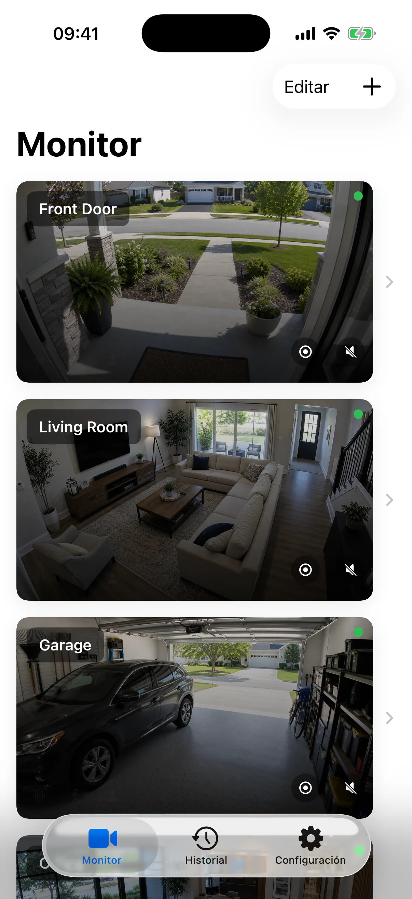
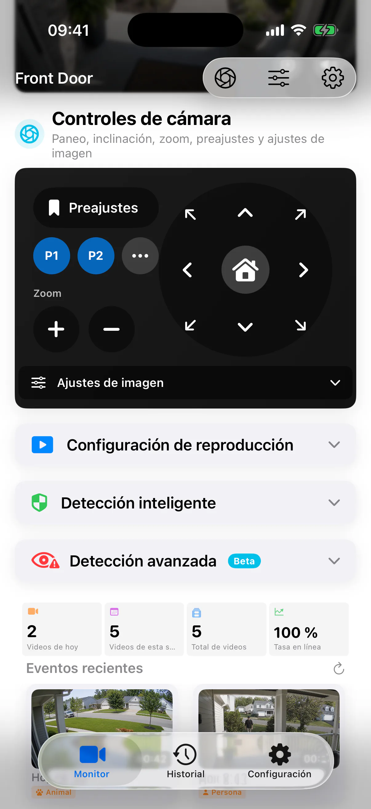

# SmartRTSP para iPhone — Visor de cámaras IP RTSP y ONVIF

Ten a mano tus cámaras IP compatibles. SmartRTSP convierte tu iPhone en un visor para tu casa, tienda o espacio de trabajo, con vídeo en directo, controles de cámara y funciones de grabación local.

**[Descargar en App Store](https://apps.apple.com/us/app/smart-rtsp-ip-camera-viewer/id6759822092)** · [Web oficial](https://www.smartrtsp.com/)

**Elige tu idioma**

[English](./README.md) · [Deutsch](./README.de.md) · [Français](./README.fr.md) · **Español** · [Italiano](./README.it.md) · [Português](./README.pt.md) · [Nederlands](./README.nl.md) · [Polski](./README.pl.md) · [Svenska](./README.sv.md) · [Suomi](./README.fi.md) · [Română](./README.ro.md) · [Русский](./README.ru.md) · [Українська](./README.uk.md) · [Türkçe](./README.tr.md)

Pasa de una consulta rápida a la vista a pantalla completa, revisa los eventos guardados y controla el giro, la inclinación y el zoom de las cámaras compatibles desde el móvil.

## Capturas de la aplicación

## Funciones principales

- **Conecta tus cámaras** — Añade transmisiones RTSP compatibles o busca cámaras ONVIF en tu red local.
- **Elige tu vista** — Alterna entre vistas individuales y una distribución multicámara adecuada para tu pantalla.
- **Graba y revisa** — Guarda las grabaciones localmente y vuelve a los momentos importantes desde el historial.
- **Encuentra eventos relevantes** — Configura las opciones compatibles de detección de movimiento, personas o sonidos para identificar los momentos que quieras revisar.
- **Controla cámaras compatibles** — Utiliza los controles de giro, inclinación y zoom cuando la cámara ofrezca un servicio ONVIF PTZ compatible.
- **Visualiza en la red local** — La visualización local de cámaras no requiere una cuenta de SmartRTSP. Puede que necesites los datos de acceso de la cámara.

## SmartRTSP en el día a día

- **Hogar y entradas** — Consulta las cámaras de una entrada, un acceso para vehículos u otras zonas de tu casa.
- **Tiendas y recepciones** — Vigila varias zonas de una pequeña tienda o recepción desde una sola pantalla.
- **Mascotas y consultas rápidas** — Abre una cámara compatible para echar un vistazo a la zona de tu mascota o a otra habitación.

## Primeros pasos

1. Instala SmartRTSP desde el enlace oficial de la tienda que aparece más abajo.
2. Conecta tu dispositivo y la cámara a la misma red local. Después, busca la cámara o añade la dirección de su transmisión compatible.
3. Introduce las credenciales de la cámara si son necesarias, abre la vista en directo y elige las funciones de visualización o grabación que quieras utilizar.

## Preguntas frecuentes

### ¿Qué cámaras funcionan con SmartRTSP?

La cámara o el grabador debe ofrecer una transmisión RTSP o un servicio ONVIF compatible. La compatibilidad depende del modelo, el firmware y los ajustes activados. Los controles PTZ también requieren una cámara compatible.

### ¿Necesito una cuenta de SmartRTSP?

Puedes ver cámaras localmente sin una cuenta de SmartRTSP. Es posible que tu cámara requiera su propio nombre de usuario y contraseña.

### ¿La descarga incluye todas las funciones?

Las pruebas, las funciones Pro, las compras disponibles y los precios varían según la plataforma. Consulta la aplicación y su ficha oficial en la tienda para conocer la oferta actual. La visualización multicámara, la grabación y la detección pueden requerir Pro.

### ¿Dónde se guardan las grabaciones?

Las grabaciones se guardan en tu dispositivo o en la ubicación que elijas cuando sea compatible. Los servicios de red opcionales siguen los ajustes que actives.

## Descargar SmartRTSP

**[Descargar en App Store](https://apps.apple.com/us/app/smart-rtsp-ip-camera-viewer/id6759822092)**

## Enlaces oficiales

- [Web oficial](https://www.smartrtsp.com/)
- [Ayuda y guías de cámaras](https://www.smartrtsp.com/guides/)
- [Política de privacidad](https://www.smartrtsp.com/privacy)

## Otras plataformas

[iPad](https://apps.apple.com/us/app/smart-rtsp-ip-camera-viewer/id6759822092) · [Apple TV](https://apps.apple.com/us/app/smart-rtsp-tv-ip-cam-viewer/id6783357198) · [Móviles y tabletas Android](https://play.google.com/store/apps/details?id=com.smartsmart.smartrtsp) · [Android TV y Google TV](https://play.google.com/store/apps/details?id=com.smartsmart.smartrtsp) · [Mac](https://apps.apple.com/us/app/smart-rtsp-pro-ip-cam-viewer/id6759788063?mt=12) · [Windows](https://apps.microsoft.com/store/detail/9NJWJKG6DK11)
